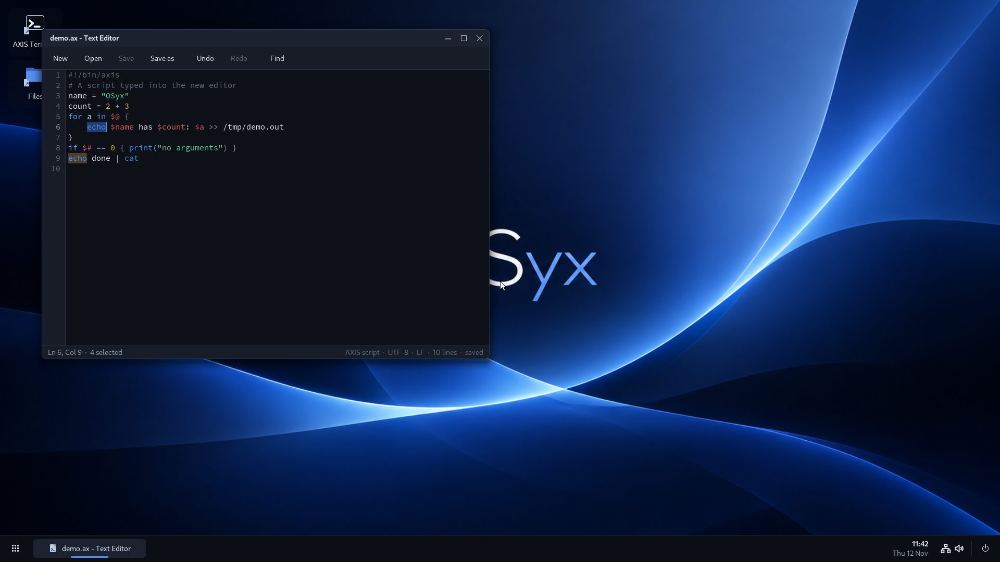
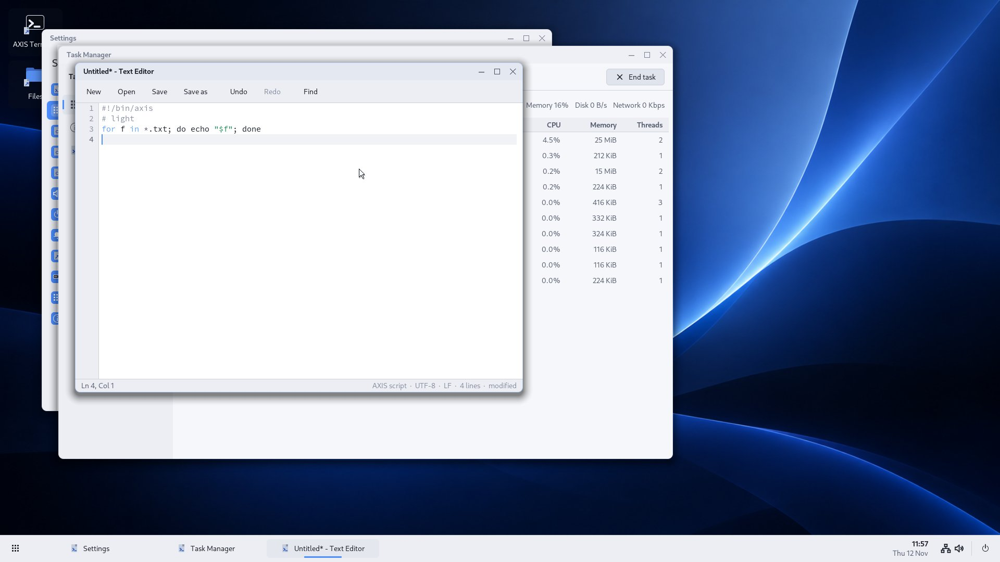
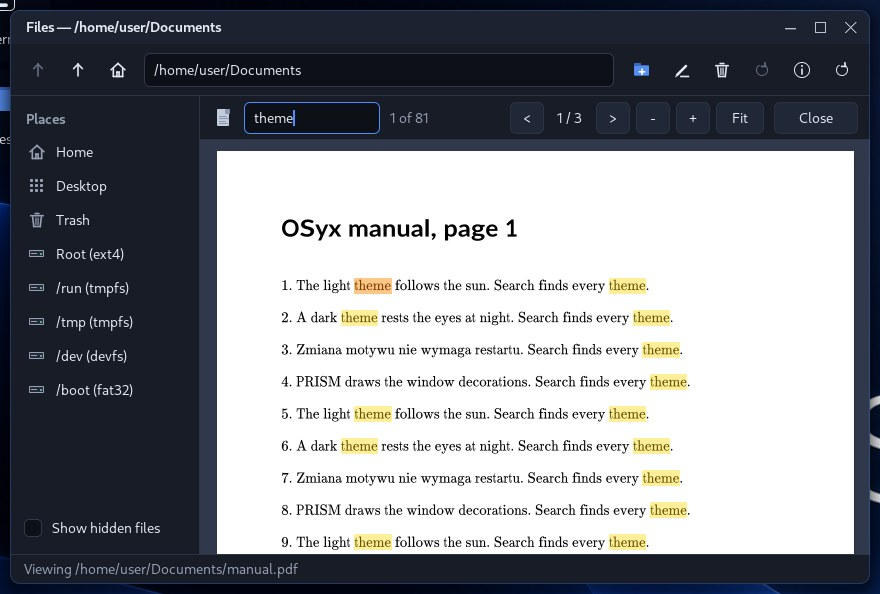
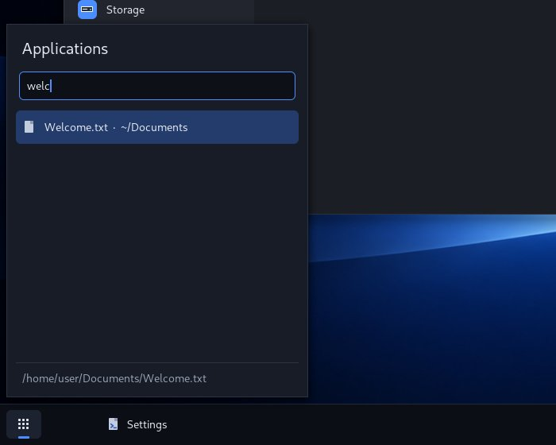

# Graphics, input and the desktop

PRISM — *many surfaces, one vision* — is the OSyx compositor. This document
covers the whole path from a USB device to a pixel on screen.

```
 USB keyboard / mouse
        │  xHCI (kernel/src/drivers/xhci)   interrupt-IN transfers, MSI-X
        ▼
 HID boot keyboard / report-protocol mouse drivers
        ▼
 input core (kernel/src/input.rs)  ── /dev/input/event<N> (per device, root)
        │                          ── /dev/input/seat0   (all devices, exclusive, root)
        ▼
 PRISM  /system/bin/prism  (ring 3, root)   ◄── display_acquire: framebuffer mapping
        │  kernel channels to the "prism" service + shared memory buffers
        ▼
 desktop shell /system/bin/desktop (shell role)   AXIS Terminal   Files   System Information
                         └── all built on prism-client + osyx-ui ──┘
```

## Kernel side

**xHCI** (`kernel/src/drivers/xhci`, structures and parsers in the
host-tested `drivers/usb` crate). Controllers are found by PCI class
0C/03/30; BAR0 is validated and mapped, bus mastering enabled, the USB legacy
handoff performed, the controller reset. Capability, operational, runtime and
doorbell registers and the extended capabilities (supported protocols →
USB 2 / USB 3 port ranges) are read from the hardware. DMA memory is
page-sized, physically contiguous kernel memory (64-bit addresses only when
the controller reports AC64); rings publish a TRB's cycle-bit dword last,
after a release fence, and ring the doorbell after a full fence. DCBAA,
scratchpads, command ring, event ring with its ERST, input/output contexts
(32- or 64-byte, as reported) and transfer rings with link TRBs are built per
the specification. Event interrupts arrive through MSI-X (or MSI) on a local
APIC vector; the handler only acknowledges and wakes the controller thread.
Every command and transfer has a timeout. Ports: connect/disconnect
detection, reset, slot enable, Address Device, GET_DESCRIPTOR (device,
configuration tree, strings), SET_CONFIGURATION, Configure Endpoint for
interrupt-IN endpoints, slot release on disconnect.

**HID**: boot-protocol keyboards (modifiers, six-key reports; rollover
error reports are detected and rejected; Caps/Num/Scroll Lock
LEDs follow the seat state) and mice in report protocol through a bounded
report-descriptor parser (buttons, X/Y, wheel), falling back to the boot
protocol (3 buttons, X/Y) when the descriptor is not understood. Only boot-protocol keyboards are supported; report-descriptor
keyboards are not yet.

**Absolute pointers**: a HID pointer whose report descriptor has absolute
X/Y is a tablet (`osyx_usb::hid::TabletLayout`): QEMU's `usb-tablet`, the
pointer VirtualBox and remote consoles present, touch screens and pens (the
tip switch is the left button). Positions reach the compositor as
`kind::ABSOLUTE` events, 0 to `ABSOLUTE_MAX` across the screen, and PRISM
maps them to pixels.

**EHCI** (`kernel/src/drivers/ehci.rs`, layouts and their tests in
`osyx_usb::ehci`): the USB 2.0 ports of PCs without xHCI (every Intel
chipset up to the 6 series: H61, P67, Z68, ...) and beside it. The driver
takes the controller from the firmware at boot (USBLEGSUP handoff, SMIs
off) before the PS/2 driver starts; one thread per controller then runs
control transfers on the asynchronous schedule and HID interrupt endpoints
on the periodic one (every frame). Intel's rate matching hub behind each
root port is driven like any high-speed hub: low and full-speed keyboards
and mice behind it get split transactions through its transaction
translator, and the hub's status change endpoint reports plugging. HID
setup is shared with xHCI (`drivers/usbhid.rs`). Only HID devices and hubs
are configured; low and full-speed devices on root ports with companion
controllers (older ICH chipsets) go to the companions, which OSyx does not
drive. `usb.ehci=off` on the kernel command line leaves the controllers to
the firmware and its PS/2 emulation.

Low and full-speed devices behind one transaction translator share its
bus: it runs their transactions one after the other, and a low-speed one
takes about a micro-frame. Their interrupt endpoints therefore start in
micro-frames 0 to 3 in turn (`osyx_usb::ehci::split_masks`), each with its
complete splits two, three and four micro-frames later; with every
endpoint starting in micro-frame 0, the fourth and later endpoints (a
keyboard and a gaming mouse have two or three each) can finish after the
last complete split and are then never heard (worked out from the USB 2.0
timing rules; not measured on hardware). An endpoint that keeps failing
rests for a second and is tried again, with the data toggle it had. A
pointer among long reports of other functions (key bitmaps, vendor data
blocks) is found; a refused SET_PROTOCOL does not stop a mouse from being
driven; the first reports that are not understood are logged in hex.

**virtio-input** (`kernel/src/drivers/virtio_input.rs`): the keyboards, mice
and tablets of a virtual machine without USB or PS/2 hardware. The device's
Linux evdev events are decoded by `osyx_input::evdev` (host tests); the event
queue is polled about 250 times a second.

**Pointer and keyboard settings**: PRISM reads `/etc/osyx/pointer` (`speed`
in percent, `natural`, `left`) and `/etc/osyx/keyboard` (`us`, `pl`, `de`,
`gb`, `fr`) when it starts and every two seconds after, so Settings applies
them without a new session. The speed scales relative motion only, with the
remainder carried to the next event.

**Input core**: one event format (`shared/input`, 32 bytes: time, device,
kind, code, values, modifier/lock state, sequence). Modifier and lock state
and key auto-repeat (500 ms / 33 ms) are per seat. Queues are bounded (256
per device, 1024 for the seat); overflow drops the oldest events and the
reader gets a `DROPPED` record. Removing a device releases its held keys and
buttons and posts `DEVICE_REMOVED`. Raw events never contain text: the
keyboard layout (US, Polish) is applied by PRISM.

**Display**: `display_info` (any process), `display_acquire` (root only; the
framebuffer is mapped write-combining into the caller, one owner at a time),
`display_release`. When the owner exits the kernel status screen returns.

On VirtIO-GPU the owner hands over changed pixels with `display_flush_rects`
(up to 64 rectangles per call): the kernel sends one TRANSFER_TO_HOST_2D per
rectangle and one RESOURCE_FLUSH of their union, so a frame costs one system
call and one host refresh (`display_flush` remains for single rectangles).
The pointer goes on the device's cursor plane: `display_cursor` uploads a
64x64 ARGB image with its hot spot (a null image hides it) and
`display_cursor_move` moves it with one cursor-queue command; no screen
pixels are drawn, copied or flushed for pointer motion. PRISM uses both when
the backend is VirtIO-GPU and keeps its software cursor overlay on the GOP
framebuffer (or with `OSYX_PRISM_SOFT_CURSOR=1`). Measured under QEMU with
`-trace virtio_gpu_*`: 40 pointer moves sent 80 transfers and 80 flushes
before, 40 cursor moves and no transfers or flushes after; opening and
closing the launcher twice sent 200 transfers and 200 flushes before, 46 and
39 after. The cursor is hidden when the display goes back to the kernel.

EDID base blocks and CEA-861 extensions are decoded by the host-tested
`drivers/display` crate. When the VirtIO-GPU offers an EDID, the kernel logs
the monitor, its mode count and the preferred mode, and starts the scanout at
the preferred mode; if the device cannot take it, the scanout's own size is
used. The `display.mode=WxH` kernel option still overrides both. AMD display
functions are identified at boot (`kernel/src/drivers/amdgpu.rs`: DCN
generation for known device IDs and the ATOM header in the VBIOS ROM), but
native DCN modesetting is not implemented and the GOP framebuffer stays in
use.

**IPC** (ABI v7): pipes, named-service channels (`channel_listen` is root
only; messages up to 64 KiB with up to 4 passed handles; per-direction
bounds of 256 messages / 1 MiB, then `WouldBlock`), shared memory objects,
`wait_handles` over any mix of them and device files.

## PRISM

`graphics/prism-core` holds every decision and is unit tested on the host:
clients and their resources, protocol validation, window stacking by role
(desktop < normal < panel < popup < notification), focus and MRU order,
server-side decorations (title, minimize/maximize/close, rounded frame,
table-driven shadow), move/resize grabs, pointer capture, keyboard routing
(Alt+Tab, Alt+F4, Super to the shell), damage tracking, fade animations and
per-client limits. Client pixels are copied at commit, so a client can
neither change the screen afterwards nor make PRISM read outside its buffer.

`userspace/desktop/src/bin/prism.rs` is the platform: it waits on the
listener, the seat and every client channel at once, renders damaged areas
into a back buffer at most every 16 ms and copies them to the framebuffer
(converting to RGBX when needed). Clients that break the protocol get an
`ERROR` and are dropped; clients that stop reading their events (512
undelivered) are dropped; a vanished client's windows fade out. PRISM starts
the desktop shell and restarts it (up to 5 times) if it exits.

### Protocol (version 1, `graphics/prism-proto`)

16-byte header (opcode, length, serial), little-endian payload, strings
with a u16 length, exact length checks. Requests: HELLO, CREATE_SURFACE,
DESTROY_SURFACE, CREATE_WINDOW, DESTROY_WINDOW, ATTACH_BUFFER (shared memory
handle in the message's handle slot 0), DESTROY_BUFFER, DAMAGE,
COMMIT_SURFACE, SET_TITLE, SET_GEOMETRY, WINDOW_ACTION, NOTIFY. Events:
HELLO, CONFIGURE, FOCUS_CHANGED, KEY_EVENT (usage, state, modifiers and the
translated character), POINTER_EVENT, CLOSE_REQUEST, BUFFER_RELEASE,
FRAME_DONE, WINDOW_LIST and NOTIFICATION (shell only), ERROR.

The shell role (desktop/panel/notification windows, global window actions,
window list) is granted only to the process PRISM started as the shell.

## Client side

* `graphics/prism-client`: `Connection` (connect with retry, HELLO,
  bounded send, event queue, waiting together with other handles),
  `Window` (shared-memory buffer grown with headroom, attach/damage/commit,
  CONFIGURE and BUFFER_RELEASE handling), and an adapter to toolkit events
  with double-click detection.
* `graphics/ui` (`osyx-ui`, host tested): themes (midnight blue/charcoal and a
  light one, blue accent), sunrise and sunset, Cantarell and Source Code Pro fonts with Polish letters, a
  clipping painter (anti-aliased rounded rectangles, discs, rings, thick
  segments), line icons, layout helpers, focus chain, and the widgets Label,
  Button, Checkbox, TextField, Panel, Menu, Dialog, ListView and
  ScrollView/Scroll. POSIX TZ parsing for the clock.

## Desktop and applications (`userspace/desktop`)

| Program | Path | Runs as |
|---|---|---|
| PRISM | `/system/bin/prism` | root (owns display and seat) |
| desktop shell | `/system/bin/desktop` | root (power control) |
| AXIS Terminal | `/system/bin/terminal` | user 1000 |
| Files | `/system/bin/files` | user 1000 |
| System Information | `/system/bin/sysinfo` | user 1000 |
| Text Editor | `/system/bin/edit [file]` | user 1000 |
| AXIS shell | `/bin/axis` | user 1000 (child of the terminal) |

Text Editor edits UTF-8 text with the toolkit's multi-line `TextArea`
(`graphics/ui/src/widget/text_area.rs`: selection, clipboard, undo and redo,
line numbers, find). AXIS scripts are coloured by the shell's own tokenizer
(`osyx_shell::highlight`), other source and configuration files by their
comments, strings and numbers. Line ends are kept as found (LF or CRLF); a
file that is not UTF-8 opens read-only; files above 8 MiB are refused. Files
offers it under "Open with" for text and source files. A save writes a new
file beside the old one (made for that save only, private until it is
complete) and renames it into place; through a symbolic link, the file the
link names is saved and the link stays. Where no file can be made beside it
(a folder that is not writable, a file of another user, or one of another
group whose group has rights of its own), the editor asks
before it writes the file in place, since a failure there loses the old
contents.



The shell draws the wallpaper (`/system/share/wallpapers/default.osxi`,
converted at build time from `graphics/assets/wallpaper/osyx-default.png` by
`scripts/png2osxi.py`; three drawn alternatives via the context menu), the
task bar (launcher, one button per window with the active one marked,
minimize/activate on click, clock from the RTC in the zone of `/etc/TZ`,
power button), the launcher (entries from `/system/share/applications/*.app`
on the root file system, search, Enter), the desktop context menu,
notification bubbles (from any client, the clock, crashed applications) and
the restart / shut down confirmation (kernel `power`).

### Files

Several files at once: Ctrl+click marks a row, Shift+click or Shift+arrows a
range, a rubber band over empty space the rows it touches, Ctrl+A all. Copy
(Ctrl+C), Cut (Ctrl+X), Paste (Ctrl+V; a name that exists becomes
`name (copy).ext`), Delete (Trash), dragging, Pack (Ctrl+P: one uncompressed
`.tar`) and Extract here (Ctrl+E) work on the whole selection. Extraction
reads tar, tar.gz/tgz, zip (stored and deflated, CRC checked), 7z and single
.gz files into a folder named after the archive; paths that would leave it
are refused and a failed extraction leaves no folder behind.

A double click opens a file with the program the user chose for its
extension, else with an installed application that lists it, else by Files
itself: text and source in the viewer, images and web pages in the default
browser, archives are extracted. Audio, video and PDF need an application:
an application says so with `Handles=mp4,mkv,video` in its `.app` file
(extensions or the kinds `text source html image audio video pdf archive`).
The right-click menu has "Open with" for every program that can open the
file (the hex viewer always can) and "Always open .ext with ...", which is
saved in `~/.config/osyx/openwith.conf` (`mp4=/opt/player`). The logic is in
`userspace/filekit` (host-tested); the file operations in
`userspace/desktop/src/fileops.rs`.

AXIS is a first, small version of the shell: built-in commands on
`os_std::fs` (`ls cat cd mkdir rm mv cp stat ps kill mounts free uptime …`),
Python-style `name = expr` and `print(...)`, `$name` expansion, and every
other word runs a program from `/bin`, `/usr/bin`, `/system/bin` with the
terminal's pipes as its standard streams. `<`, `>` and `>>` redirect the
standard input and output of a command — built-ins included, using
`os_std::io::redirect_stdin`/`redirect_stdout` — and `|` connects programs
and at most one built-in into a pipeline. The built-in stage runs in the
shell process after the programs around it have started, so waiting for
output cannot deadlock. `if cond { ... } else { ... }` and
`for name in words { ... }` group lines; conditions are expressions with
`==`, `!=`, `<`, `>`, `<=` and `>=`. Still open: job control.

## Boot

`init.args=desktop` makes `/bin/init` run `/system/bin/prism` (restarting it
up to three times); without it init runs its checks as before. If PRISM
cannot start, init exits and the kernel status screen stays.

## Testing

* Host: `drivers/usb` (registers, TRBs, rings, contexts, descriptors, HID
  reports, malformed input), `drivers/display` (EDID base and CEA-861
  parsing, checksums, detailed timings, mode selection, truncated and
  malformed blocks), `graphics/prism-proto`, `graphics/prism-core`
  (blending, clipping, damage, stacking, focus, resizing, input routing,
  protocol validation, disconnect clean-up, limits), `graphics/ui` (layout,
  focus, every widget's behaviour, clipping, icons, dates and time zones).
* QEMU, `scripts/desktop-test.ps1` (stage 6 of `scripts/test.ps1`): boots
  into the desktop with `qemu-xhci`, `usb-kbd`, `usb-mouse` and no PS/2
  controller, and drives it only through QMP input injection: pointer
  motion and clicks, the context menu, the launcher with Super and typed
  search, commands typed into the terminal (a program spawned by AXIS),
  moving, resizing, maximizing, focusing, minimizing from the task bar and
  closing windows, the file manager on ext4 (navigate, open, create a
  folder), a third application, killing a client while PRISM keeps running,
  unplugging the USB keyboard, and PRISM's frame statistics. Screenshots are
  kept in `build/test/desktop-*.png`.

## Task Manager and Settings

`/system/bin/taskmgr` has Processes, Details and Performance pages. Its
60-sample CPU/memory/disk/network graphs use ABI v10 scheduler, frame,
physical block-I/O and interface counters. CPU is tick-sampled on the
single scheduled CPU; per-process totals retain samples of exited threads.
Rates divide by measured elapsed time. The sortable process list preserves
selection by PID; End task uses the existing kernel permission checks.

`/system/bin/settings` shows General, Appearance, Displays, Keyboard,
Date & Time, Network, Storage and About. Host name, accent, background,
US/Polish keyboard layout and POSIX time zone write system configuration;
DHCP/static IPv4 applies through the native net_config syscall. Keyboard
layout needs a session restart. The desktop reloads background/time zone.
Display information is read-only. Settings retains root credentials for system configuration.

Appearance also chooses the theme: Dark (`MIDNIGHT`), Light (`DAYLIGHT`) or
Automatic, kept in `/etc/osyx/theme` as `dark`, `light` or `auto`. Automatic
is light while the sun is up: `osyx_ui::time::sun_times` computes sunrise
and sunset for the day from the solar declination and the equation of time
(within a few minutes of an almanac; polar day and night are handled). The
place is `latitude longitude` in `/etc/osyx/location` when that file exists;
otherwise the longitude is the middle of the time zone and the latitude
50 degrees north. Every native application, the desktop shell and PRISM
(window decorations, `prism_core::theme::Palette`) look at the choice every
three seconds, so a change of theme or accent, and sunrise and sunset, show
in running programs without a restart. The terminal keeps its dark
background in both themes.



### Text in PDF files

The PDF viewer built into Files searches and selects text. Ctrl+F opens a
search field: every match in the document is marked as its pages are
searched on the viewer's thread, the count is shown, Enter or F3 goes to
the next match and Shift+Enter to the one before; Escape closes the field.
Dragging over a page selects its text, a double click a word, Ctrl+A the
page in view; Ctrl+C copies the selection.

`osyx_media::pdf::Pdf::text` runs a page's content without painting and
keeps each glyph's text and box (`pdf::text::PageText`). The text of a
glyph comes from the font's ToUnicode map, else its glyph name, else the
embedded font's own character map read backwards. Characters stay in the
order the page draws them; a space is added where the page leaves a gap
and a line break where the text moves to another line. Invisible text
counts, so scanned pages with a text layer can be searched. Searching
ignores case, and a space matches a line break.



### Screenshots and screen recording

PrintScreen belongs to PRISM, whichever window has the focus:

| Keys | What is captured |
|---|---|
| PrintScreen | the whole screen |
| Alt+PrintScreen | the focused window with its title bar |
| Shift+PrintScreen | an area: press, drag, release; Escape or a click without a drag gives up |
| Ctrl+PrintScreen | starts recording the screen; again, stops and saves |

A picture is a PNG in `~/Pictures`, a recording a WebM file with VP8 video
in `~/Videos`, both named by the UTC time. The saved file goes onto the
clipboard as a file (Paste in Files copies it; Win32 programs see
`CF_HDROP`) and as its path in text, and the shell shows a notification.
The clipboard holds at most 56 KiB, so the picture itself is not put on it.

PRISM is root, and root writes nothing in the user's home: a folder there
could be a symbolic link to anywhere. A child process (`prism
--save-as-user`, `userspace/desktop/src/user_save.rs`) gives up root, makes
the folder and the file as the desktop user and gets the length and the data
through a pipe, so the captures are the user's own; a file that did not
arrive whole is removed by the child, not by root. A recording is written in
`/var/cache/osyx-prism`, which only root can reach, and handed over when it
is finished. A `~/Pictures` or `~/Videos` that an earlier version made as
root is not the user's: the child renames it to `Pictures (old)` or
`Videos (old)`, where its files stay readable, and makes the user's own
folder. A recording leaves the spool only once the user
has it: one that could not be handed over, or that a PRISM which died left
cut off, is saved after the next recording, under `name (2)` and so on when
the name is taken.

While an area is chosen the compositor keeps the pointer from the windows
and draws the outline; the picture is taken from the frame after the
outline is gone.

The recorder (`userspace/desktop/src/recorder.rs`) copies the composed
screen, with the pointer, at most ten times a second and only when it
changed (once a second otherwise), and a thread of its own encodes and
writes; frames it cannot keep up with are dropped. Each frame carries its
time, so the film keeps its pace. The encoder
(`osyx_media::vp8::encode`) writes key frames with 16x16 intra prediction
every fifty frames and, between them, frames predicted from the same place
in the previous one, where an unchanged macroblock costs a fraction of a
bit. It has no motion search and no loop filter. It reconstructs each
frame as a decoder does; the tests check that this crate's decoder shows
exactly that picture, and libavcodec did too for a sample. Colours stay
within a few levels of the screen. `osyx_media::video::webm` writes the
container with cues for seeking; a recording that was cut off still plays
up to its last complete cluster.

The launcher's search field also finds settings and files once two
characters are typed (`osyx_filekit::search`). A setting ("wallpaper",
"wifi", "time zone", also by related words such as "background") opens
Settings at its section (`settings <section>`). Files and folders are
matched by name against a list of the home directory made when the launcher
opens (up to 5000 entries, five levels deep, hidden names left out); a file
opens in Files as a double click would (`files --open FILE`), a folder
opens in Files. Applications come first, then up to four settings and
twelve files, each group best match first.



The application launcher also accepts `.exe` paths, invoking `/bin/winrun`.
The four Windows GUI utilities are installed in `/opt/apps` and have their
own launcher entries. They draw through the same PRISM compositor.

## Known limitations

* Software composition uses one compositor thread; applications can run on
  different CPUs. Cursor updates bypass the application frame limit and
  copy only the old/new pointer rectangles. Full-window commits from the
  toolkit applications (damage is tracked by PRISM, clients report it but
  the toolkit apps redraw whole windows).
* Popups and notifications are square (no per-pixel alpha in the toolkit
  yet; the protocol supports ARGB buffers).
* HID: boot-protocol keyboards; hubs on xHCI and EHCI; no UHCI/OHCI
  (companion controllers of older chipsets); EHCI drives HID and hubs only;
  no isochronous or bulk endpoints; no USB 3 streams.
* No IOMMU support (none is assumed); DMA buffers are kernel pages.
* AXIS is minimal (see above); the terminal is a line-mode terminal.
